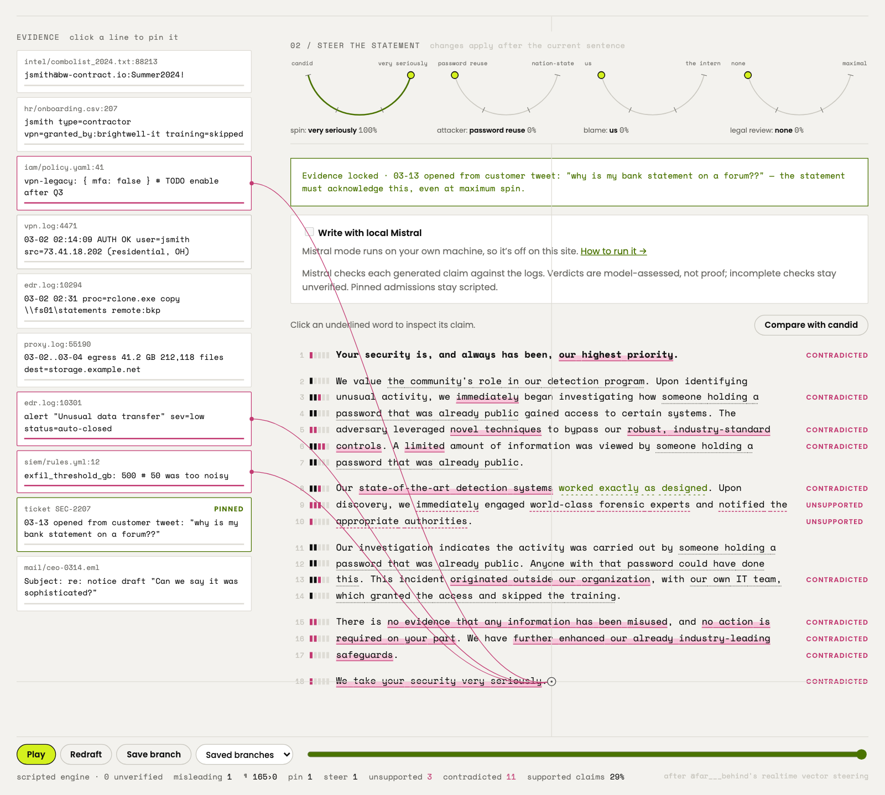

# Breach Post-Mortem

**A breach notice that writes itself from the logs. Turn up the spin and watch every claim lose its evidence in real time.**

**▶ Try it: [thesefa.github.io/breach-post-mortem](https://thesefa.github.io/breach-post-mortem/)** (best on a desktop, works on a phone)



Every breach notice says the company "takes your security very seriously." This one shows its working. As the statement writes itself, every claim is wired to the log lines that back it up, or to the ones that contradict it.

- **White thread:** the claim is supported by evidence.
- **Red thread:** the evidence says otherwise. The claim is stamped CONTRADICTED.
- **Dangling red ╳:** nothing backs the claim at all. It's stamped UNSUPPORTED.

## Updated interaction

- Start in the **spin laboratory**: drag the four-stop slider to compare the same facts with increasingly evasive wording instantly.
- The statement starts candid. Steering arcs sit above it and stay visible while scrolling on desktop.
- Click an underlined claim (or focus it and press Enter) to pause and inspect its evidence. **Back to live** resumes the statement.
- **Compare with candid** opens a full baseline using the same evidence.
- **Save branch** preserves the current text, planned continuation, controls, and pins. Restore a saved branch to explore a different continuation. Branches last for the current page session only.
- Amber **MISLEADING** claims preserve a technically supported detail while omitting important context. Unsupported attribution is no longer presented as disproven, and file counts are not treated as customer counts.
- Telemetry identifies the scripted engine and reports the share of supported claims; it does not display invented inference speed or latency.

## Things to try

- **Drag the SPIN arc** from *candid* to *very seriously* while it's writing. Everything after the cursor rewrites itself: "a contractor reused a leaked password" becomes "the adversary leveraged novel techniques to circumvent our robust, industry-standard controls." The text already written stays frozen.
- **Turn the other dials:** *attacker* (password reuse → nation-state), *blame* (us → the intern) and *legal review* (none → "may, in limited circumstances, have potentially…").
- **Click a log line to pin it.** The statement has to admit it, however much it squirms. Pin the customer tweet at maximum spin and you get "We value the community's role in our detection program."
- **Drag the timeline back** to rewind and pick a different future.
- **Watch the bottom bar:** it counts unsupported and contradicted claims, and keeps a running **supported claims** percentage.

## How it works

There's no AI model inside. It's a small scripted engine plus a page that draws it, so it's instant and works the same for everyone.

1. **Evidence.** Ten fictional log lines (VPN, EDR, proxy, IAM policy, a ticket, one email), each with an id.
2. **Claims.** The statement is built from 12 beats (headline, how they got in, what was taken, detection, blame, apology…). Every beat has four versions, one per spin level. Each claim inside a sentence lists the evidence it **cites** and the evidence that **contradicts** it.
3. **Dials.** Each dial snaps to four levels. Spin chooses the tone, *attacker* and *blame* fill in who did it, and *legal review* swaps plain verbs for hedged ones.
4. **Frozen past, steerable future.** Words are emitted at a steady rate. When you change a dial, only the not-yet-written text is regenerated.
5. **Pins.** A pinned log line that hasn't been cited yet forces an admission sentence (a candid one or a spun one, depending on the spin level).

The full walkthrough is in [docs/how-it-works.md](docs/how-it-works.md).

## Run it locally

No build step and no dependencies. Open `index.html` in a browser, or serve the folder:

```bash
python3 -m http.server 8765
```

Engine tests (Node 18+):

```bash
node --test engine.test.js
```

## Files

| File | What it is |
|---|---|
| `index.html` | The page: layout, evidence threads, dials, timeline, telemetry |
| `engine.js` | The engine: evidence, dials, sentence variants, admissions. Pure and deterministic |
| `engine.test.js` | Engine tests (`node:test`) |
| `docs/` | How-it-works guide, the original design and plan, images |

## The fine print

Brightwell Mutual, `jsmith`, the logs and the breach are all **fictional**. Any resemblance to your last post-mortem is purely painful.

## Credits

- Made by **Sefa** ([THESEFAWAY](https://www.thesefaway.com/)). Idea and direction are mine. I built it with [Claude Code](https://claude.com/claude-code).
- The steering interface (focus gutter, pinning, radial dials, timeline scrubbing, speculative text) is inspired by [@far___behind's "Realtime LLM Vector Steering"](https://www.instagram.com/reel/DfyQPhFtW-z/).

## License

[MIT](LICENSE)

## Optional local Mistral mode

With Ollama running and `mistral:latest` installed:

```bash
npm run serve:model
```

Open **http://127.0.0.1:8766** and enable **Write with local Mistral** above the statement. The original static preview (`npm run serve`) remains available without a model. Override the model with `BREACH_MODEL=your-installed-model npm run serve:model`.

The Node server binds only to loopback and sends the fictional scenario to Ollama on this device. No API key, cloud inference, or extra npm dependencies are used. It checks request origin and serves only public app assets.

Mistral rewrites upcoming statement beats, one at a time, while the current sentence finishes. Steering, pinning, redrafting, or rewinding cancels stale work. The statement waits at the relevant sentence boundary if the model is still drafting. Drafts are cut to one sentence. If a draft claims a fix the logs never show ("we're reviewing our policies"), the server retries once, then keeps the scripted sentence and Mistral stays on. Requests time out after 45 seconds; if the model is unreachable, the page switches back to scripted mode. Toggle the checkbox to retry.

The live GitHub Pages site has no server, so the toggle is off there; clone the repo to use it. `npm run eval:model` runs the evidence checker against claims with known verdicts and fails if any is wrongly marked supported. The spin laboratory at the top remains an instant scripted preview.

Model-written sentences receive a separate evidence review. The reviewer assigns **supported, contradicted, misleading, or unsupported**, with explanations and literal log excerpts. Labels are explicitly **model-assessed**: they are fallible judgments, not proof. Compound sentences receive one conservative verdict; all assertions must be supported to earn that label. Failed or incomplete checks remain **unverified · AI**. Pinned admissions stay scripted so their facts are acknowledged even if the model's language is evasive. Use claim inspection to see the distinction. Local mode requires the Node server; a GitHub Pages deployment alone cannot run it.

Evidence checking runs locally after drafting and can add latency. `verifier.js` splits text into exact sentences, validates evidence IDs and literal quotations, and preserves the generated wording. The reviewer has a 25-second budget inside the existing 45-second request limit. Click a claim to inspect its verdict, rationale, quoted excerpts, and original log records.
